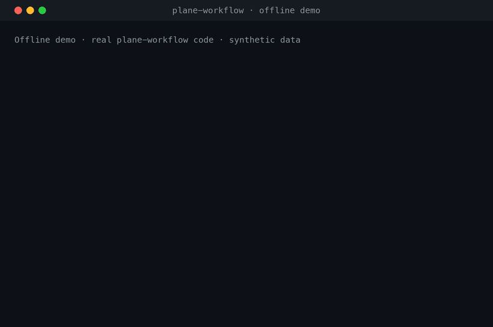

# Plane Workflow MCP

**Your coding agent does the work. This makes Plane show it, without manual updates.**

An open-source [MCP](https://modelcontextprotocol.io/) server for [Plane](https://plane.so/),
including self-hosted Plane. Claude Code, Codex, Cursor, and other agents can plan,
start, and complete Plane work items under your team's rules. They preview every
change first and record what was actually done and how it was verified.

[](https://github.com/amirhosseinkz/plane-workflow-mcp/actions/workflows/ci.yml)



<sub>Offline demo: the real server code runs against a test fixture with synthetic data.
[Reproduce it](docs/demo.md).</sub>

## What it does

- **Plan → start → complete, with evidence.** New work gets scope, acceptance
  criteria, assignee, estimate, and start/target dates that skip your non-business
  days. Completion requires a started item, a factual summary, and real
  verification. It never fabricates either.
- **Preview first, safe to retry.** Write tools support `dry_run` previews. Creates
  check for duplicates and are idempotent, so a timeout followed by a retry does not
  create a second item. Rate limits are retried with backoff.
- **Know what needs attention.** Read-only briefings list overdue, stale, unassigned,
  unestimated, and unscheduled work. Reports export to DOCX or PDF.
- **Never touch the wrong project.** Writes are tied to the selected workspace and
  project, unless one call explicitly confirms another project's identifier.

## Quick start

Requires Python 3.11+, [uv](https://docs.astral.sh/uv/), and a Plane API key.

```bash
uv tool install https://github.com/amirhosseinkz/plane-workflow-mcp/releases/download/v0.6.0/plane_workflow_mcp-0.6.0-py3-none-any.whl
plane-workflow setup --client claude-code
```

Setup asks for your Plane URL, workspace, and API key. It checks the connection,
stores the key in your OS keyring, and registers the server with your client. Other
clients: `--client codex`, `cursor`, `claude-desktop`, `opencode`, or `zed`; any other
stdio client can run `plane-workflow mcp`. Add `--dry-run` to see the change first.

Using Claude Code? You can [install it as a plugin](docs/installation.md#install-the-claude-code-plugin)
instead, which also adds a skill for using the tools safely.

Select a project, then restart your client:

```bash
plane-workflow project list
plane-workflow project activate PROJECT_ID
```

### Update

`plane-workflow status` shows your version and, when a newer release exists, the
exact command to install it. Run that command, then restart your client. Your
setup, API key, and selected project are kept, so there is no need to run setup again.

## First prompt

```text
Use Plane Workflow to confirm my active workspace and project, then show overdue
and unassigned work in that project with identifiers and totals. Do not change
any Plane data.
```

Then try a write with a preview:

```text
Retrying checkout can create two orders. Draft a bug with acceptance criteria in
the active project using its workflow rules. Show the dry-run preview and wait for
my approval before creating it.
```

[More prompts with expected results](docs/examples.md) ·
[Run the offline demo](docs/demo.md)

## How it compares

The [official Plane MCP server](https://github.com/makeplane/plane-mcp-server) gives
broad access to Plane resources and hosted OAuth. This server adds a workflow layer
on top of Plane: planning rules, an enforced lifecycle, previews, idempotent writes,
and completion records. You can install both.
[Detailed comparison](docs/comparison.md).

Review happens in your client. The server enforces planning rules and lifecycle
checks, but it cannot prove a human approved a call. Plane is updated when the agent
calls a tool; there is no background sync.

## Documentation

- [Installation, clients, and troubleshooting](docs/installation.md)
- [Planning rules, lifecycle, batch work, and reports](docs/workflows.md)
- [Workflow examples](docs/examples.md) · [Offline demo](docs/demo.md)
- [Optional Mattermost bot](plugins/plane-workflow/mattermost-bot/README.md)
- [Roadmap](docs/roadmap-100-stars.md) · [Changelog](CHANGELOG.md)
- [Contributing](CONTRIBUTING.md) · [Support](SUPPORT.md) · [Security](SECURITY.md)

MIT licensed. Community project, not affiliated with Plane.
